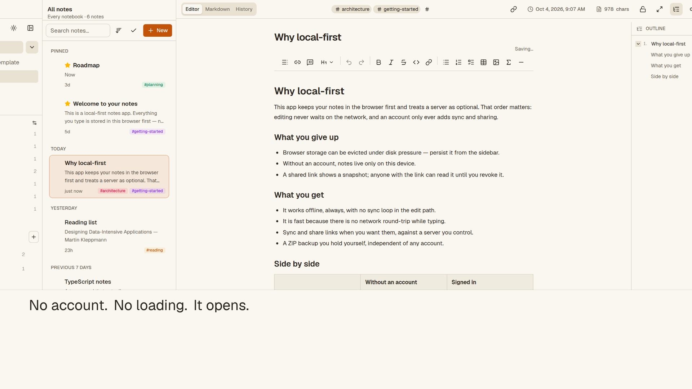

# Sidenote

[](https://github.com/awbuilds/sidenote/actions/workflows/ci.yml)
[](LICENSE)

A private, local-first notes and knowledge base. Web only, with optional
self-hosted sync. Live at **https://sidenoteapp.vercel.app**.

The hosted demo is local-only: no account and no upload. Sync is enabled only
on deployments configured with their own Supabase.

A classic three-pane notes layout. **No third-party app code is copied**; this
is a fresh implementation of the interaction model, not a port.



## What this is

**Local-first by default.** Every note lives in your browser's IndexedDB, and
the app works with no network at all. There is no account and no server unless
you configure one.

**Optional self-hosted sync.** Setting the two `NEXT_PUBLIC_SUPABASE_*` env
vars enables sign-in, cross-device sync, and public share links against a
Supabase instance you control. Without them every remote path is a no-op, and
the app is exactly as private as the local-only build.

The trade is explicit: with sync you get multi-device notes and share links,
and your data lives on the server you chose; without it, notes cannot leave the
machine. There is no third-party analytics, advertising, or AI in either mode.

**The one real risk:** browser storage is *evictable*. The operating system can
clear this origin's IndexedDB under disk pressure, silently, with no chance to
intercept it. The app asks for eviction protection and shows you whether it
got it — but the only durable answer is to **export a ZIP backup regularly**.
Settings → Backup.

## Features

- **Three panes** — nested notebooks, note list, editor. Collapses to one pane
  on a phone, with back navigation. The sidebar collapses to an icon rail so
  the editor keeps the width.
- **Nested notebooks** — unlimited depth, drag to re-parent, reorder. Cycles are
  refused, and corrupt data is recovered rather than making a notebook vanish.
- **Editor** — TipTap, with a raw Markdown view over the same document.
- **Outline** — document headings nested by level, collapsible, click to jump,
  with the section you're reading highlighted.
- **Rich blocks** — tables, LaTeX equations, images, links, task lists,
  headings, dividers, quotes, code.
- **Templates** — meeting notes, task list, daily log.
- **Slash commands** — type `/` at the start of a block for every block type.
- **Note links** — `[[Note Title]]` links between notes, with a backlinks
  panel. Stored as plain text, so they survive a Markdown round trip, a ZIP
  backup and an HTML export. A link to a note that does not exist yet resolves
  itself when you create it.
- **Code block languages** — set on the block, exported as a fenced block.
- **Autosave** — debounced, flushed on tab close and on note switch. A failed
  save keeps the payload and offers Retry.
- **Version history** — a snapshot per save, capped by count and age.
- **Tags and search** — MiniSearch in a Web Worker, prefix matching, with the
  index persisted so page loads stay fast.
- **Sorting** — by last edited, created or title, with pinning respected.
- **Images** — paste or drop them in. Re-encoded to WebP with the longest edge
  capped at 2560px before being stored.
- **Trash** — restore, per-note purge, empty trash.
- **Export** — Markdown, standalone HTML with every image embedded, or a full
  ZIP backup. Import from that ZIP, or from an Evernote `.enex`.
- **Installable** — PWA with an app-shell service worker, so it launches
  offline. Focus mode (⌘⇧F) and a command palette (⌘K).

## Running it

```bash
npm install
npm run dev      # http://localhost:3000
```

| Command | |
|---|---|
| `npm run typecheck` | `next typegen && tsc --noEmit` |
| `npm run test` | Vitest |
| `npm run lint` | ESLint |
| `npm run build` | Production build |

**All four must be clean before a change is done.** They are also not
sufficient — every one of them has passed on a build that then threw at
runtime. Anything client-side also needs `npm run dev` and a read of
`.next/dev/logs/next-development.log`.

## Architecture

```
src/app/          routes. Everything is a client surface
src/components/   layout · editor · notebooks · notes · settings · share · sync · ui
src/lib/db/       Dexie schema and repositories — the only IndexedDB access
src/lib/          tiptap · search · image · transfer · storage · seed · supabase · sync · share
src/hooks/        queries (read) and mutations (write)
supabase/         Postgres schema, RLS and migrations for optional sync
docs/plans/       the product plan
docs/SELF-HOSTING.md  how to self-host with your own Supabase
docs/handoffs/    one note per phase, newest last
```

`AGENTS.md` is the onboarding contract for agents working in this repo, and it
records the traps that have actually cost time here: IndexedDB rejects `null`
and booleans as keys; React 19 refuses a `<script>` rendered as JSX children
(the theme script uses `dangerouslySetInnerHTML`); `npm run dev` rewrites part
of `AGENTS.md` itself.

## Two things worth knowing about the data

**`contentJson` is the source of truth.** `contentMarkdown` and `contentText`
are derived on every save. Never read them as authoritative.

**Attachments store `Uint8Array`, not `Blob`.** Not a preference: `Blob` does
not survive every structured-clone implementation, and an untestable backup
path is not acceptable for the only copy of this data.

## Deploying and self-hosting

Sidenote is a standard Next.js app. It runs **local-only** with no backend, or
with **your own Supabase** for accounts, sync and share links. The full guide —
Vercel, Docker, any Node host, Supabase migrations, auth redirects and the
build-time variables — is in **[docs/SELF-HOSTING.md](docs/SELF-HOSTING.md)**.

With no environment variables the app stores everything in the browser and needs
no server. To enable optional accounts and cross-device sync, set two variables
at **build time** (see `.env.example`):

```
NEXT_PUBLIC_SUPABASE_URL=https://your-project.supabase.co
NEXT_PUBLIC_SUPABASE_ANON_KEY=<anon key>
```

`NEXT_PUBLIC_*` values are inlined by Next.js at build time, so rebuild after
changing them. The anon key is public by design; never put the service-role key
in the client.

Vercel: connect the repository, add the variables, deploy. Docker:
`docker compose up --build` (pass the two build args). The service worker only
becomes real once the app is served over HTTPS from the deployed origin.

## Sync (optional)

Signing in is never required. When the Supabase env vars are present, the app
gains an `/auth` page, a "Sign in to sync" entry in the sidebar, and a Sync
section in settings; local writes are pushed with last-write-wins
(`updated_at`, with a grace window), remote changes are pulled on focus, on
reconnect, every minute, and after each mutation. Deletions propagate through
local tombstones. If a remote edit overwrites a local note, the local content
is preserved as a version snapshot first.

**Attachments sync as bytes** through the private `attachments` bucket: a new
image uploads when it is added, other devices download it on first sync, and
delete propagates via a server-side soft delete. Free accounts include
**50 MB of synced attachment bytes** (enforced server-side), and images are
compressed to WebP before upload, so the budget goes far. Version snapshots
are not synced yet.

The self-hosting guide is `docs/SELF-HOSTING.md`; the schema lives in
`supabase/migrations/`.

## Not built (deliberately)

Version-history sync, images inside shared links, non-image attachments,
multi-device *live* push (sync reconciles on focus, on reconnect, and on an
interval — not Realtime), AI features, MCP, plugins, diagram notes,
mobile/desktop apps.

## Contributing

Read `CONTRIBUTING.md`. `main` is protected: every change lands through a pull
request with a green CI run. Security reports go through `SECURITY.md`, never a
public issue.

## Licence

Sidenote is free software, licensed under the **GNU Affero General Public
License v3.0**. Copyright (C) 2026 Abhijith Warrier. See [LICENSE](LICENSE).
Because the app is served over a network, the source is linked from
Settings → About as well as from this repository.
